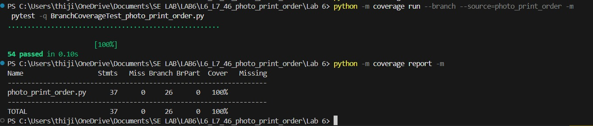

# SE Lab 6: Code and Branch Coverage Analysis

## Student Details
- **Name:** Thijil Thejaswi M.N.
- **SRN:** PES1UG24AM412
- **Course:** Software Engineering Lab (UE24CS252AA)
- **Topic:** Code Coverage and Branch Coverage Analysis

---

## 1. Experiment Overview & Objectives

Software testing coverage metrics quantify how thoroughly a test suite exercises application source code. This experiment focuses on white-box testing strategies applied to a photo print order system:
1. **Code Coverage (Statement Coverage):** Ensures that every executable line and statement in the application module is executed at least once during testing.
2. **Branch Coverage (Decision Coverage):** Ensures that every boolean decision outcome evaluates to both `True` and `False`, exercising all control flow paths, compound condition branches, and boundary conditions.

---

## 2. Application Architecture

The application module under test is `photo_print_order.py`, containing three core business logic functions:

### 2.1. `extra_print_charge(print_size, copies, finish, is_member)`
Calculates charges for prints ordered beyond the included quota:
- Included quotas: `{"4x6": 20, "5x7": 15, "8x10": 10}`.
- Membership bonus: +5 included prints for non-8x10 sizes (`4x6` and `5x7`).
- Finish rates: `matte` = \$4 per extra print; other finishes (e.g., `glossy`, `canvas`) = \$7 per extra print.
- High-volume surcharge: If extra prints > 50, rate increases by \$2. If finish is `canvas`, an additional \$5 is added.
- Input validation: Raises `ValueError("unknown print size")` for invalid sizes, and `ValueError("invalid copies")` if `copies < 0`.

### 2.2. `order_valid(file_mb, copies, is_rush)`
Determines whether an order is accepted based on constraints:
- Rush orders (`is_rush == True`): Accepted if `copies <= 50`.
- Regular orders (`is_rush == False`): Rejected if `file_mb > 25`, otherwise accepted if `copies <= 500`.

### 2.3. `dispatch_status(hours_before_dispatch, is_framed, is_international)`
Determines the dispatch readiness status (`"on_time"`, `"tight"`, or `"missed"`):
- Base cutoff: 24 hours if framed, 12 hours if unframed.
- International shipping adds 24 hours to the cutoff.
- Cutoff combinations:
  - Unframed Domestic = 12h
  - Framed Domestic = 24h
  - Unframed International = 36h
  - Framed International = 48h
- Status intervals:
  - `"on_time"` if `hours >= cutoff`
  - `"tight"` if `cutoff - 6 <= hours < cutoff`
  - `"missed"` if `hours < cutoff - 6`

---

## 3. Difference Between Code Coverage and Branch Coverage

| Aspect | Code Coverage (Statement Coverage) | Branch Coverage (Decision Coverage) |
|:---|:---|:---|
| **Definition** | Measures the percentage of executable statements executed by the test suite. | Measures the percentage of decision branch outcomes (True/False) traversed. |
| **Granularity** | Line / statement level. | Control flow branch / decision level. |
| **Decision Logic** | An `if` statement without an `else` achieves 100% statement coverage if executed when `True`, ignoring the `False` branch. | Requires tests for both `True` (branch taken) and `False` (branch skipped). |
| **Rigor** | Basic baseline; leaves edge conditions and alternate paths untested. | Stronger metric; subsumes statement coverage and validates boundary logic. |

---

## 4. Tools & Environment

- **Python Version:** 3.12.10
- **Test Framework:** `pytest` (v9.1.0)
- **Coverage Tool:** `coverage.py` (v7.17.2)
- **Operating System:** Windows 11

---

## 5. Test Suites and Execution Instructions

### 5.1. Code Coverage Test Suite (`CodeCoverageTest_photo_print_order.py`)

Exercises every executable statement across all three functions, handling normal paths, boundary returns, and exceptions.

**Execution Commands:**
```bash
coverage erase
coverage run --source=photo_print_order -m pytest -v CodeCoverageTest_photo_print_order.py
coverage report -m
```

*(Note: The code coverage run measured statement coverage using `--source=photo_print_order` without `--branch`.)*

**Verified Results:**
- **Test cases:** 21
- **Statements:** 37
- **Missed statements:** 0
- **Statement coverage:** **100%**

---

### 5.2. Branch Coverage Test Suite (`BranchCoverageTest_photo_print_order.py`)

Tests both `True` and `False` outcomes of every conditional decision, compound boolean sub-expressions, boundary values, and exception triggers:
- Member and non-member conditions (including 8x10 exclusion).
- All print sizes (`"4x6"`, `"5x7"`, `"8x10"`, unknown sizes).
- All finish options (`"matte"`, `"glossy"`, `"canvas"`, custom finishes).
- Included and additional print boundaries (`extra <= 0`, `extra == 0`, `extra == 1`).
- High-volume print boundaries (`extra == 50`, `extra == 51`, canvas surcharge).
- Invalid inputs and exceptions (`copies < 0`, unknown size).
- Rush vs. regular order conditions (`is_rush == True` vs. `False`).
- File size and copy-count boundaries (`file_mb == 25` vs. `25.1`, `copies == 500` vs. `501`).
- Framed and non-framed dispatch.
- International and domestic dispatch.
- On-time, tight, and missed dispatch boundaries across all 4 cutoff values (12h, 24h, 36h, 48h).

**Execution Commands:**
```bash
coverage erase
coverage run --branch --source=photo_print_order -m pytest -v BranchCoverageTest_photo_print_order.py
coverage report -m
```

**Verified Results:**
- **Test cases:** 54
- **Statements:** 37
- **Missed statements:** 0
- **Branches:** 26
- **Partial branches:** 0
- **Coverage:** **100%**

---

## 6. Coverage Summary Comparison

| Test Suite | Total Tests | Statements Covered | Missed Stmts | Statement Coverage | Branches Covered | Partial Branches | Branch Coverage |
|:---|:---:|:---:|:---:|:---:|:---:|:---:|:---:|
| **Code Coverage Suite** | 21 | 37 / 37 | 0 | **100%** | N/A* | N/A* | N/A* |
| **Branch Coverage Suite** | 54 | 37 / 37 | 0 | **100%** | 26 / 26 | 0 | **100%** |

*\*Note: The code coverage suite was executed with `--source=photo_print_order` (without `--branch`) to measure statement coverage specifically.*

---

## 7. Deliverable File Structure

```text
SE_LAB_6/
│
├── photo_print_order.py
├── CodeCoverageTest_photo_print_order.py
├── BranchCoverageTest_photo_print_order.py
├── README.md
│
└── screenshots/
    ├── CodeCoverage.jpeg
    └── BranchCoverage.jpeg
```

---

## 8. Verification Screenshots

- **Code Coverage Screenshot:** [`screenshots/CodeCoverage.jpeg`](screenshots/CodeCoverage.jpeg)
  Demonstrates all 21 test cases passing and 100% statement coverage.
  
  

- **Branch Coverage Screenshot:** [`screenshots/BranchCoverage.jpeg`](screenshots/BranchCoverage.jpeg)
  Demonstrates all 54 test cases passing, 26/26 branches covered, and 100% branch coverage.
  
  
