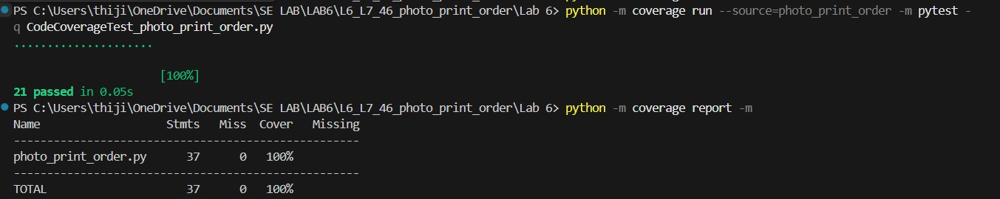

# SE Lab 6: Code and Branch Coverage Analysis

## Student Details
- **Name:** Thijil Thejaswi M.N.
- **SRN:** PES1UG24AM412
- **Course:** Software Engineering Lab (UE24CS252AA)
- **Topic:** Code Coverage and Branch Coverage Analysis

---

## 1. Experiment Overview & Objectives

Software testing coverage metrics quantify how thoroughly a test suite exercises application code. This experiment evaluates and implements white-box testing strategies on a photo print order system:
1. **Code Coverage (Statement Coverage):** Ensures that every executable line and statement in the application module is executed at least once.
2. **Branch Coverage (Decision Coverage):** Ensures that every boolean decision point evaluates to both `True` and `False`, exercising all execution paths and boundary conditions.

---

## 2. Application Architecture

The application module under test is `photo_print_order.py`, containing three core business logic functions:

### 2.1. `extra_print_charge(print_size, copies, finish, is_member)`
Calculates the charge for extra prints beyond the included quota:
- Quotas: `{"4x6": 20, "5x7": 15, "8x10": 10}`.
- Member perk: +5 included prints for non-8x10 sizes (`4x6` and `5x7`).
- Finish rates: `matte` = \$4 per extra print; other finishes (e.g., `glossy`, `canvas`) = \$7 per extra print.
- High-volume surcharge: If extra prints > 50, rate increases by \$2. If finish is `canvas`, an additional \$5 is added.
- Input validation: Raises `ValueError("unknown print size")` for invalid sizes, and `ValueError("invalid copies")` if `copies < 0`.

### 2.2. `order_valid(file_mb, copies, is_rush)`
Determines if an incoming print order is valid:
- Rush orders (`is_rush == True`): Accepted if `copies <= 50`.
- Regular orders (`is_rush == False`): Rejected if `file_mb > 25`, otherwise accepted if `copies <= 500`.

### 2.3. `dispatch_status(hours_before_dispatch, is_framed, is_international)`
Determines the dispatch readiness status (`"on_time"`, `"tight"`, or `"missed"`):
- Base cutoff: 24 hours if framed, 12 hours if unframed.
- International shipping adds 24 hours to the cutoff.
- Cutoff combinations: Unframed Domestic = 12h, Framed Domestic = 24h, Unframed International = 36h, Framed International = 48h.
- Status: `"on_time"` if `hours >= cutoff`; `"tight"` if `cutoff - 6 <= hours < cutoff`; `"missed"` if `hours < cutoff - 6`.

---

## 3. Difference Between Code Coverage and Branch Coverage

| Aspect | Code Coverage (Statement Coverage) | Branch Coverage (Decision Coverage) |
|:---|:---|:---|
| **Definition** | Measures the percentage of executable statements executed by the test suite. | Measures the percentage of decision branch outcomes (True/False) traversed. |
| **Granularity** | Line/statement level. | Control flow branch/decision level. |
| **Decision Logic** | An `if` statement without an `else` achieves 100% statement coverage if executed when `True`, ignoring the `False` branch. | Requires tests for both `True` (branch taken) and `False` (branch skipped). |
| **Rigor** | Basic baseline; leaves edge conditions and alternate paths untested. | Stronger metric; subsumes statement coverage and validates boundary logic. |

---

## 4. Tools & Environment

- **Python Version:** 3.12.10
- **Test Framework:** `pytest` (v9.1.0)
- **Coverage Tool:** `coverage.py` (v7.17.2)
- **Operating System:** Windows 11

---

## 5. Code Coverage Test Suite (`CodeCoverageTest_photo_print_order.py`)

The Code Coverage test suite exercises every executable line and statement across all three functions, handling both normal execution and exception paths.

### 5.1. Execution Command
```bash
coverage erase
coverage run --source=photo_print_order -m pytest -v CodeCoverageTest_photo_print_order.py
coverage report -m
```
*(Note: Code coverage run measured statement coverage using `--source=photo_print_order` without `--branch`)*

### 5.2. Verified Results
- **Test cases:** 21 passed
- **Statements:** 37
- **Missed statements:** 0
- **Statement coverage:** **100%**

### 5.3. Screenshot
- Terminal execution output and coverage report:
  
